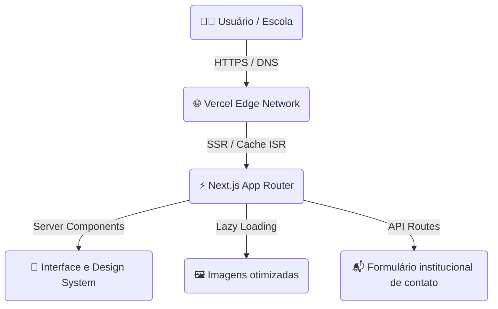

# Robótica Educativa UNIVASF

> Plataforma web oficial do programa de extensão universitária da **Universidade Federal do Vale do São Francisco (UNIVASF)** para democratização do ensino de robótica pedagógica, programação e ciência em escolas públicas da região.

## 🎯 Objetivo e impacto

- 🚀 **Capacitação prática:** cursos e oficinas presenciais de robótica livre e lógica de programação para estudantes da rede pública.
- 📖 **Materiais didáticos abertos:** disponibilização de apostilas, roteiros de montagem e guias práticos para professores e alunos.
- 🏫 **Ponte universidade-escola:** canal institucional para agendamento de visitas escolares, oficinas e participação em mostras científicas.

## ✨ Principais funcionalidades

- 📱 **Portal institucional responsivo:** apresentação clara da metodologia pedagógica e do impacto social do programa.
- 🛠️ **Catálogo de oficinas e atividades:** estruturação visual das frentes de aprendizado, como Arduino, eletrônica básica e pensamento computacional.
- 📸 **Galeria e registro de eventos:** exposição fotográfica e documental das ações realizadas nas escolas.
- 📬 **Canal direto de contato:** formulário otimizado para integração rápida entre escolas e coordenadores do projeto.

## 👨‍💻 Minha atuação no projeto

- 🏗️ **Arquitetura frontend:** estruturação completa do projeto com Next.js App Router e TypeScript, com foco em modularidade e manutenção.
- 🎨 **Design system e UI/UX:** criação de uma interface moderna, limpa e responsiva com Tailwind CSS, priorizando estudantes e docentes.
- ⚡ **Otimização e desempenho:** implementação de carregamento sob demanda, otimização de imagens e redução do pacote inicial.
- 🚀 **Pipeline de CI/CD e deploy:** configuração do fluxo automatizado de integração e publicação na Vercel.

## 🛠️ Stack e decisões técnicas

- ⚡ **Next.js App Router:** renderização híbrida para oferecer resposta rápida e conteúdo indexável.
- 🔷 **TypeScript:** tipagem estrita de componentes e modelos para aumentar a confiabilidade do código.
- 🎨 **Tailwind CSS:** design tokens consistentes e CSS utilitário para acelerar a construção da interface.
- ☁️ **Vercel Edge Network:** distribuição global dos arquivos com compressão automática e baixa latência.

## 📐 Topologia de arquitetura

## 🛡️ Desafios técnicos e soluções

- ♿ **Acessibilidade universal (WCAG):** necessidade de atender estudantes e educadores com diferentes dispositivos e níveis de letramento digital.
- **Solução:** semântica estruturada, contraste alinhado à WCAG 2.1 e navegação por teclado e leitores de tela.
